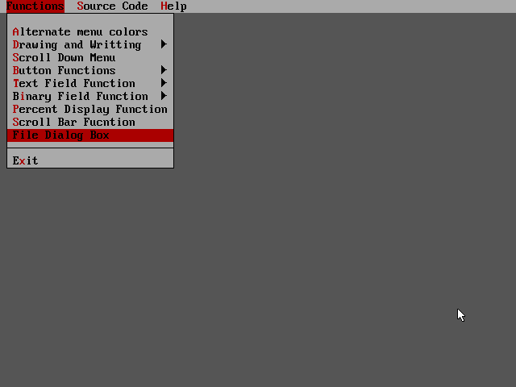
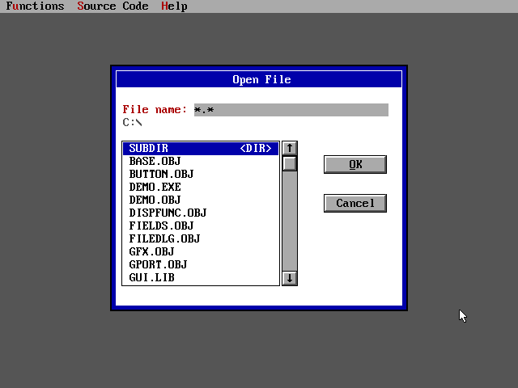
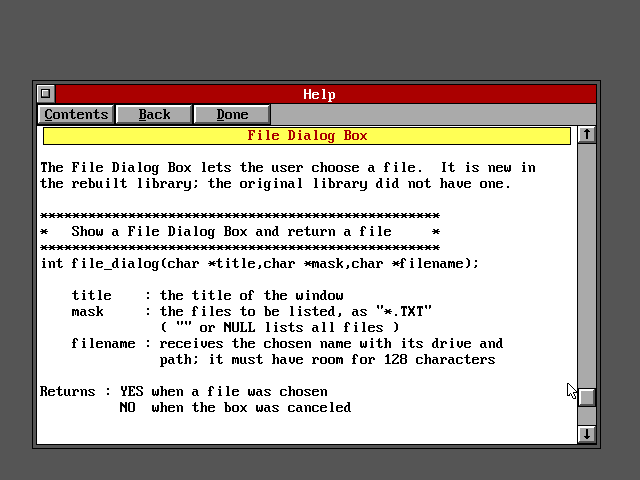
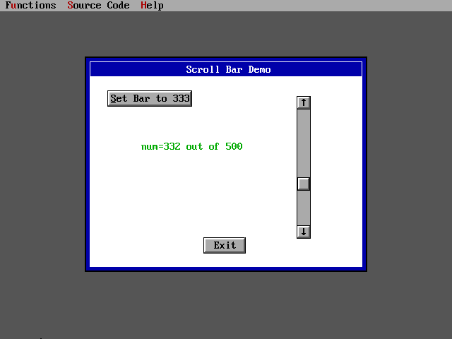
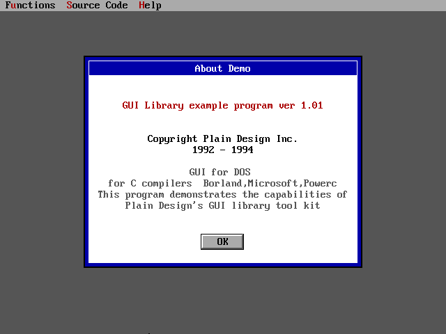
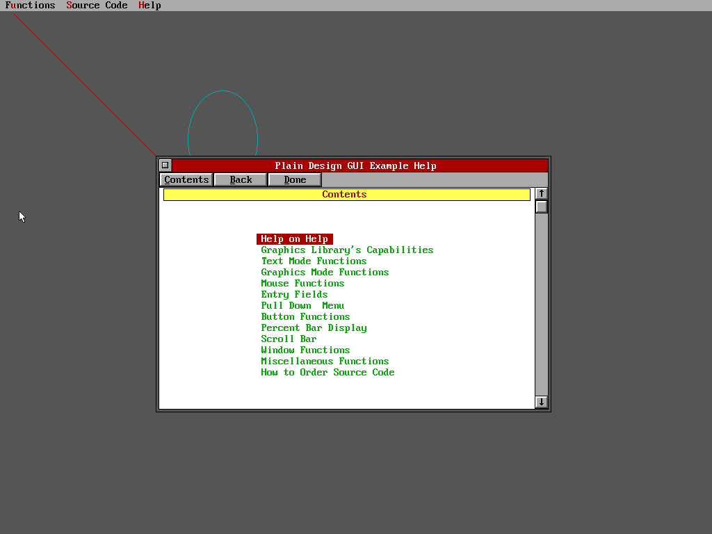

# DOSGUI

A small GUI library for DOS programs written in C: pull-down menus, windows,
buttons, entry fields, a scroll bar, a percent bar, hypertext help and a file
dialog, all drawn in VGA and VESA graphics modes while the program keeps
working in text coordinates.

It began as the **Graphics User Interface Library by Plain Design Inc.,
ver 1.01** (January 1994), a shareware library that shipped as binaries for
Borland C, Microsoft C and Power C. Its source was sold separately and is
long gone. The `src` folder holds that library **rebuilt as C source** from
the Borland binary, checked against the library's own help file and against
the original example program.

| | |
| --- | --- |
| <br>The pull-down menu | <br>The file dialog (new) |
| <br>The hypertext help window | <br>The scroll bar |
| <br>A window with a button | <br>The same program at 1024 x 768 |

## What the rebuild adds

- **Higher resolutions.** The original was made for 640 x 480 in 16 colors.
  The rebuilt library also runs at 800 x 600, 1024 x 768 and 1280 x 1024, in
  16 or 256 colors, through the VESA BIOS. The text screen grows with the
  mode: 128 x 48 characters at 1024 x 768, for example.
- **16-bit and 32-bit programs.** The same source builds a large-model
  real-mode library and a 32-bit DOS/4GW one with Open Watcom.
- **A file dialog box**, `file_dialog()`, which the original never had.
- **The original interface.** `GUI.H` is unchanged apart from additions, and
  the original `DEMO.C` compiles against the rebuilt library as it is.

## Building

With [Open Watcom 2](https://github.com/open-watcom/open-watcom-v2) on
Windows, in the `src` folder:

```
build           16-bit:  build16\gui.lib and build16\demo.exe
build 32        32-bit:  build32\gui.lib and build32\demo.exe
```

The batch file looks for Open Watcom in `C:\WATCOM` unless `WATCOM` is set.

Run the example in DOS or DOSBox-X from its build folder:

```
demo            640 x 480, 16 colors
demo 104        1024 x 768, 16 colors
demo 105        1024 x 768, 256 colors
```

`src/README.TXT` has the full table of modes, the list of files, how the
rebuild was checked, where it deliberately differs from the original, and
what has not been tested.

## How faithful it is

The original `DEMO.EXE` and the rebuilt demo were run side by side in
DOSBox-X with the same keystrokes at 640 x 480 and their screens compared
pixel by pixel. The About box, the menus, the drawing functions that were
tried, the fields, the buttons, the scroll bar and the help window came out
identical.

Not everything has been tried. Mouse actions (dragging windows, clicking,
dragging the scroll bar) are rebuilt from the original's code but were not
tested, and nothing has been run on real hardware. See `src/README.TXT`.

## What is in the repository

- `src/` - the rebuilt library, the example, the build file.
- The top folder - the original 1994 distribution, untouched: the three
  libraries, `GUI.H`, `DEMO.C`, `DEMO.EXE`, `HELPFILE`, `MENUFILE`, and the
  archive it came in.
- `screenshots/` - the pictures above.

## Origin and rights

The library is the work of Plain Design Inc. (Midland Park, New Jersey),
copyright 1992-1994. Its own README says of the binaries: "You may use this
library, copy it and pass it along to others free of any obligations to
Plain Design Inc." The source was offered for sale at the time; an order
sent in 1994 was never answered, and the company could not be reached then
or since.

The source here is not Plain Design's own: it was reconstructed from their
binary so that the library can still be built and used today. It is shared
in that spirit, for people who like old DOS toolkits. If you are the author,
or hold the rights, and would like this repository changed or taken down,
please open an issue and it will be done.
